# Biscuit — a Shiba Inu Tamagotchi for the ESP32-S3 AMOLED

A virtual pet dog for the **Waveshare ESP32-S3-Touch-AMOLED-1.8** (368×448 AMOLED touchscreen). Feed him, play ball, give him baths, put him to bed, and pet him by tapping. He walks around his room, gets the zoomies when he's happy, and lets you know when he needs something.

All the art was generated with **Higgsfield** (GPT Image 2.5) and converted to RGB565 for the display.

<p align="center">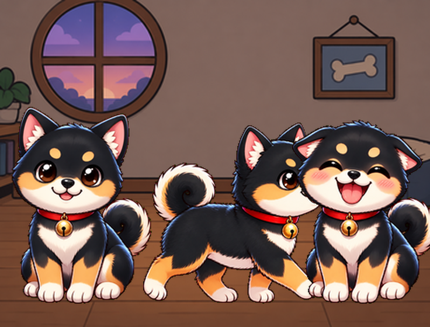</p>

## Features

- **Four needs** that drain over time: 🦴 food, ⚽ fun, ⚡ energy, 💧 clean
- **Feed**: he alternates between dipping into the bowl and lifting his head to chew. Later he poops, so tap the poop to clean it.
- **Play**: you throw a ball and he gallops after it, catches it, and you throw it again
- **Wash**: soap bubbles, then he shakes himself dry and water drops fly everywhere
- **Sleep**: the room goes dark, Zzz's float up, and he wakes up on his own when his energy is full
- **Pet**: tap him and he does happy hops, with hearts
- **On his own**:
  - He walks around the room using a 4-frame walk cycle and turns to face where he's going.
  - He blinks, barks "Woof!", and gets zoomies when he's happy.
  - He looks sad and asks for help when a need gets low.
- **Squash & stretch**: he breathes while sitting, squashes when he lands, and stretches up on every woof
- **Shake the board** (QMI8658 IMU) and he gets dizzy
- His stats are saved to flash, so Biscuit survives power-offs. One "dog day" is one hour powered on (Puppy → Junior → Adult).
- The screen dims after 45 s of no touches; tap it to wake it

## Controls

| Input | Action |
|---|---|
| FEED / PLAY / WASH / SLEEP buttons | Care for Biscuit |
| Tap the dog | Pet him |
| Tap a poop | Clean it up |
| Shake the board | Dizzy dog |
| Hold **BOOT** for 3 s | Adopt a new puppy (reset) |

## Sprites

Every sprite was made with Higgsfield from one base image, so the character stays consistent. Each one was generated on a pure-green background, then chroma-keyed out by `tools/convert_sprites.py`.

### Poses

| Idle | Blink | Happy | Bark | Sad |
|:-:|:-:|:-:|:-:|:-:|
| 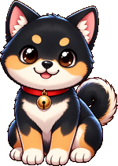 | 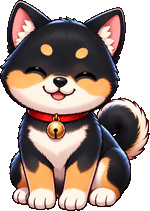 | 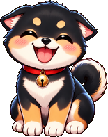 | 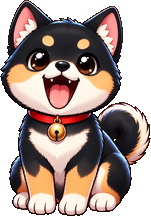 | 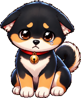 |

| Dizzy | Bath | Sleep | Eat (dip) | Eat (chew) |
|:-:|:-:|:-:|:-:|:-:|
| 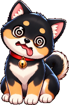 | 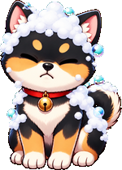 | 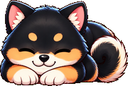 | 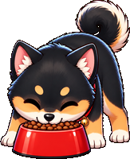 | 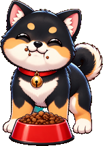 |

### Walk cycle (played 1 → 2 → 3 → 2, mirrored when walking left)

| Walk 1 | Walk 2 | Walk 3 |
|:-:|:-:|:-:|
|  | 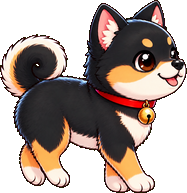 | 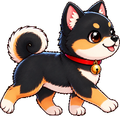 |

### Gallop (zoomies and chasing the ball)

| Run 1 | Run 2 |
|:-:|:-:|
| 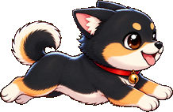 | 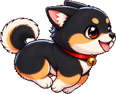 |

### Room

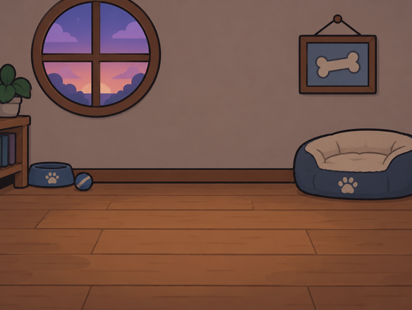

### First version: orange Shiba

The original Biscuit was an orange Shiba. Those sprites are kept in `sprites_src_v1_orange/`.

| Idle | Blink | Happy | Eat | Sleep |
|:-:|:-:|:-:|:-:|:-:|
| 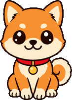 | 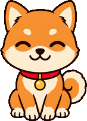 | 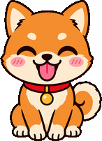 | 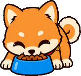 | 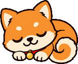 |

| Sad | Play | Bath | Bark | Dizzy |
|:-:|:-:|:-:|:-:|:-:|
| 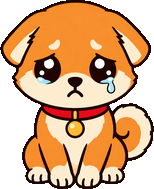 | 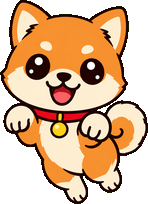 | 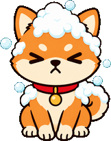 | 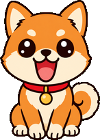 | 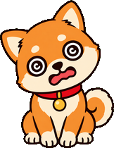 |

## Hardware

**Waveshare ESP32-S3-Touch-AMOLED-1.8** (also sold on AliExpress as "ESP32-S3 1.8inch AMOLED Touch Display Development Board"):

| Part | Details |
|---|---|
| MCU | ESP32-S3R8: 8 MB octal PSRAM, 16 MB flash |
| Display | 368×448 AMOLED over QSPI (CS 12, SCK 11, D0–D3 = 4–7) |
| I2C | SDA 15, SCL 14 |
| IO expander | TCA9554 @ 0x20 (P0 LCD reset, P1 display power, P2 touch reset) |
| IMU | QMI8658 @ 0x6B |

There are **two hardware revisions**, and the sketch detects which one you have at boot:

| | Display | Touch |
|---|---|---|
| V1 | SH8601 | FT3168 @ 0x38 |
| V2 | CO5300 (16 px column offset) | CST820 @ 0x15 |

## Building & flashing

You need:

- Arduino IDE 2 or `arduino-cli`
- The **esp32 core 3.3.x**
- The **GFX Library for Arduino** 1.6.4 or newer

Board settings (`ESP32S3 Dev Module`):

| Setting | Value |
|---|---|
| PSRAM | OPI PSRAM |
| Flash Size | 16MB |
| Partition Scheme | 16M Flash (3MB APP/9.9MB FATFS) |
| USB CDC On Boot | Enabled |

```bash
arduino-cli compile --fqbn "esp32:esp32:esp32s3:PSRAM=opi,FlashSize=16M,PartitionScheme=app3M_fat9M_16MB,CDCOnBoot=cdc" .
```

```bash
arduino-cli upload -p COM6 --fqbn "esp32:esp32:esp32s3:PSRAM=opi,FlashSize=16M,PartitionScheme=app3M_fat9M_16MB,CDCOnBoot=cdc" .
```

### Troubleshooting a black screen

- **Restart after flashing:** hold **PWR** for 6–8 s until the board is off, then press it again. If a battery is fitted, unplugging USB isn't enough, and the board can stay in download mode after a flash.
- **Write-protected flash:** if an erase "finishes" in 0.0 s or uploads fail with an MD5 mismatch, the flash's block-protect bits are set. Clear them, then erase:
  ```bash
  esptool --chip esp32s3 -p COM6 write-flash-status --non-volatile --bytes 2 0
  ```
  ```bash
  esptool --chip esp32s3 -p COM6 erase-flash
  ```
- **Serial monitor:** opening the serial port with DTR/RTS toggled can reset the board into download mode. Read with DTR and RTS both off.

## Changing the art

1. Put the PNGs in `sprites_src/`. Use a 1024×1024 image on a pure green `#00FF00` background for each dog frame, and any image for the `room.png` background.
2. Run `python tools/convert_sprites.py` to regenerate `sprites.h` and `sprites.cpp`.
3. Run `python tools/make_docs.py` to refresh the README images.

The pixel data is written as string literals, so the 1 MB+ of sprites compiles in seconds. Frames from the same animation share one crop box, so cycles don't jitter.

## Files

| File | What it is |
|---|---|
| `dog_tamagotchi.ino` | The game: rendering, behaviour, touch, IMU, saving |
| `pet_types.h` | Sprite, activity and mode enums |
| `sprites.h` / `sprites.cpp` | Generated RGB565 sprite data |
| `sprites_src/` | Full-resolution Higgsfield images (black Shiba) |
| `sprites_src_v1_orange/` | The original orange Shiba sprites |
| `tools/convert_sprites.py` | Converts PNGs to RGB565 for the display |
| `tools/make_docs.py` | Builds the README images |
